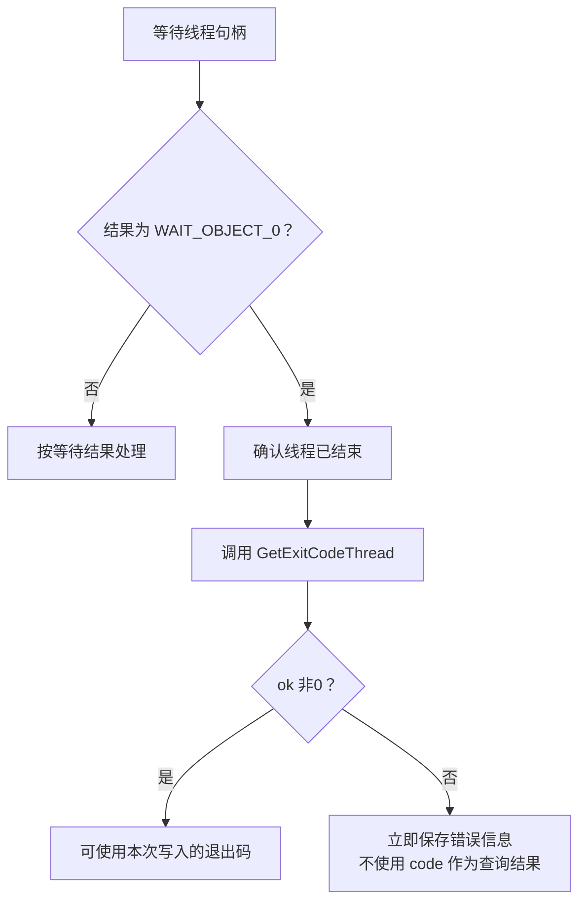

# 任务08：线程结束了，为什么还可能拿不到退出码？

建议阅读5分钟，最后检查2分钟；不要求运行。对应本书1.3的GetExitCodeThread。本次只解决“等待成功”和“查询成功”的关系。

## 1. 原书入口

来源：王端明《深入浅出Windows API程序设计：核心编程篇》1.3，EPUB/xhtml/Chapter01_0004.xhtml，以段落开头定位。以下为原文：

> 其他线程可以通过调用GetExitCodeThread函数来检查hThread参数指定的线程是否已终止运行，如果已终止，可以返回其退出码：

以下例子、图示及解释由助手补充。原文的“返回其退出码”要按函数接口理解：退出码经输出参数写入，函数自身返回BOOL以报告查询成功与否。

## 2. 两次调用各自负责一件事

| 操作 | 回答的问题 | 不能由它证明的事 |
|---|---|---|
| WaitForSingleObject等到线程有信号 | 这条线程是否已结束？ | 下一次查询是否成功、退出码是多少 |
| GetExitCodeThread查询成功 | 系统是否成功把状态写入输出变量？ | 仅凭调用成功不能断言线程已结束；本课先等待确认结束 |

**结束是线程的状态；查询成功是一次API调用的结果。**

比如：线程已经结束，而手里的句柄仅有等待所需的SYNCHRONIZE权限，缺少查询所需的权限，就可能等到结束却无法查询退出码。这是解释两项条件独立的边界例子，不表示CreateThread默认返回的句柄通常缺少这些权限。

## 3. 看谁真正写了code

教学片段，假设工作线程正常return 23：

```cpp
DWORD code = 99;                         // 主线程自己先写99
DWORD r = WaitForSingleObject(h, INFINITE);
// 已知r == WAIT_OBJECT_0：现在只确认线程结束
// WaitForSingleObject没有收到&code，不会把23写进code

BOOL ok = GetExitCodeThread(h, &code);    // 这一步才请求写入状态
if (ok != 0)
{
    // 查询成功；又已确认线程结束，才在这里使用code
    // 在本例正常return 23的前提下，code为23
}
else
{
    DWORD error = GetLastError();        // 失败后立即保存错误原因
    // 不使用code作为本次查询得到的线程退出码
}
```

如果ok为0，问题是“查询没成功”。再次等待只能再次检查线程状态，**不会重新执行GetExitCodeThread，也不会替它把输出变量变成有效结果**。下一步先取得错误信息，再依据错误原因决定如何处理；不盲目循环。

失败后不承诺code一定仍为99，也不凭“数字看起来合理”使用它；这里应直接把它视为没有获得可信的本次查询结果。

## 4. 把两个条件连起来（助手绘制）



GitHub阅读页支持此流程图；桌面预览器不支持时，按上方代码从上往下读即可。

等待线程结束返回WAIT_OBJECT_0，其数值为0；GetExitCodeThread查询成功返回非0。每个API都有自己的返回约定，不能把“0代表成功”套到所有函数。单对象等待使用WAIT_OBJECT_0，不是WAIT_OBJECT_1。

## 5. 读完再做一个小检查

先遮住上文。无需重做上一套题，用两行解释下面两种情况：

某工作线程正常return 31，主线程已经成功等到它结束。线程句柄一直保持有效，没有线程在期间关闭它。随后程序查询退出码：

- 情况A：GetExitCodeThread返回0。此时能否使用输出变量作为线程退出码？接下来先做什么？为什么再次等待解决不了这次失败？
- 情况B：GetExitCodeThread返回非0。此时输出变量是多少？为什么这里判断的是“非0”？

我的回答与理由：

信心（高/中/低）：

实际用时（阅读/答题，未计时写未记录）：

是否回看材料/用了什么提示：

手机上可直接在聊天回答“A：……；B：……”，也可填写桌面本文件后告诉我“任务08完成”。本题检查关键因果，不考函数拼写；核心关系已清楚只剩小问题时，提醒后推进。

## 官方依据

已于2026-11-03核对：[GetExitCodeThread的输出参数、BOOL返回值及句柄权限](https://learn.microsoft.com/en-us/windows/win32/api/processthreadsapi/nf-processthreadsapi-getexitcodethread)；[WaitForSingleObject的等待结果及SYNCHRONIZE权限](https://learn.microsoft.com/en-us/windows/win32/api/synchapi/nf-synchapi-waitforsingleobject)。以上为概括，代码是教学片段，不是用户实际运行证据。
