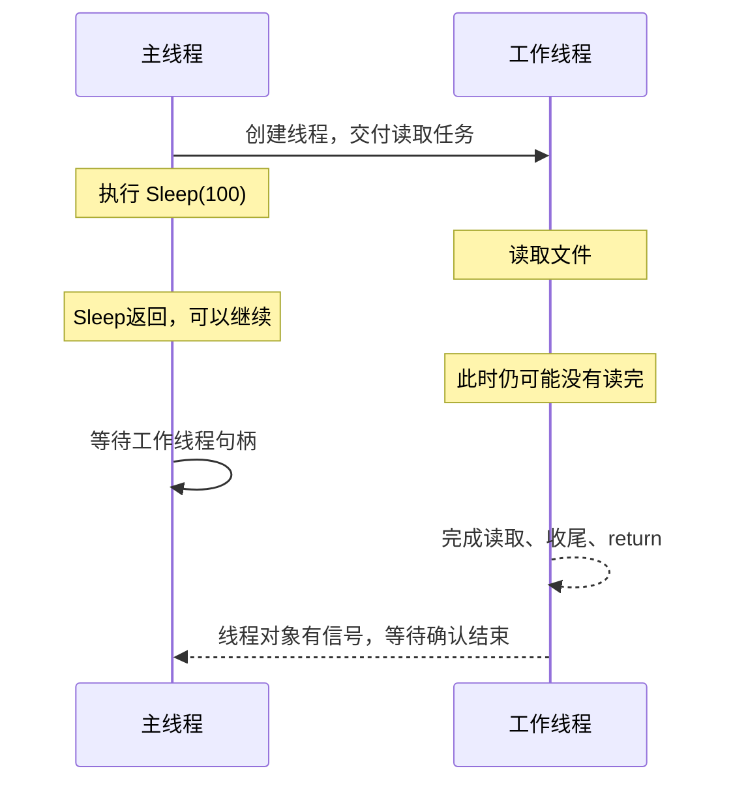

# 任务10：延时与线程通知——从1.3进入1.4

日期：2026-11-04。建议阅读10～12分钟、两问3分钟；静态学习，不要求运行。目标：知道Sleep影响谁，理解“过了一段时间”和“某项工作完成”是不同条件，再认识线程通信的用途。

## 一、先看一个具体问题

工作线程要读一个文件。主线程想等它读完，再显示结果。现在不需要会写文件API，只把“读文件”当作一项耗时不确定的工作。

主线程创建工作线程后，执行Sleep(100)，然后马上显示“读取完成”。这不可靠：有的文件读得快，有的读得慢；主线程睡过这一段时间，不能据此确定工作线程已经做完。

如果需要确认整个工作线程结束，使用你已经学过的等待线程句柄，并检查WAIT_OBJECT_0。如果只想获知一条新进度、允许下一步执行，则需要程序明确传达对应的信息或条件，这就是接下来线程通信的用途。

以上为助手的具体场景。下面先接上原书1.3最后的Sleep。

## 二、Sleep原文与接口

来源：王端明《深入浅出Windows API程序设计：核心编程篇》1.3，EPUB/xhtml/Chapter01_0004.xhtml，以下两段原文保留措辞，原型只统一空白与缩进。

> 调用Sleep函数可以暂停执行当前线程，直到指定的超时时间结束：

```cpp
VOID WINAPI Sleep(_In_ DWORD dwMilliseconds); // 以毫秒为单位
```

> 即告知系统，在一段时间内自己不需要被调度。如果dwMilliseconds参数设置为0，表示告知系统放弃本线程在当前CPU时间片的剩余时间，系统可以转去调度其他线程，待该线程轮流到下一个时间片时再继续执行。

助手补充：当前线程就是“正在执行这次Sleep调用的线程”。主线程调用，主线程延时；工作线程调用，工作线程延时。参数中没有另一个线程的句柄，所以不能用Sleep指定另一个线程暂停。

```cpp
// 在主线程里执行
Sleep(100);   // 主线程暂时不往下执行；工作线程仍可被调度

// 在工作线程里执行
Sleep(100);   // 当前这个工作线程暂时不往下执行
```

Sleep没有返回值，不返回等待结果，也不返回工作线程退出码。

Sleep(0)表示让出当前时间片剩余部分，自己仍处于就绪状态；没有其他就绪线程时可以立即返回。它不能保证某一条指定的工作线程已经获得运行机会，更不能保证那条线程执行完。

原文用“轮流到下一个时间片”帮助理解；实际调度受多种条件影响，不能按固定轮次预测线程先后。非零延时也不是精密计时：系统时钟分辨率会影响延时，恢复就绪后也不保证立即运行。本课不需要修改系统计时设置。

## 三、用一条可能的时间线分清因果

下面是助手绘制的一种可能顺序，不是所有机器的固定时长：



Sleep的继续条件是延时安排结束；等待线程结束的继续条件是线程对象有信号。即使某次运行中二者刚好都在工作完成后返回，也不代表它们提供相同保证。

窗口的主线程需要持续处理消息。若在按钮处理函数里Sleep(10000)，它会有十秒左右不能正常处理后续消息，窗口可能无响应；这一点与你初测解释的主线程被长计算占用相连。

## 四、1.4为什么需要线程通信？

来源：同书1.4，EPUB/xhtml/Chapter01_0005.xhtml，开头两段原文：

> 主线程创建工作线程时可以通过线程函数参数向工作线程传递自定义数据。当工作线程开始运行后，主线程可能还需要控制工作线程，工作线程有时也需要将一些工作情况主动通知给主线程。常用的线程间通信方式有全局变量、自定义消息和事件对象（Event）。

> 最简单常用的方式是使用全局变量，例如CounterThread程序就是通过在主线程中设置g_nOption变量的值来控制工作线程的工作。使用全局变量传递数据的缺点是当多个工作线程使用同一个全局变量时，由于每个线程都可以修改全局变量，因此可能会引起同步问题，后面会探讨这个问题。

下面按你已学过的线程关系解释三个入口，暂时不展开完整API代码：

| 方式 | 一个具体用途 | 先记住的边界 |
|---|---|---|
| 共享变量 | 保存各线程都要访问的状态或数据 | 共用同一份数据不等于自动协调了访问，需要相应的同步安排 |
| 自定义消息 | 工作线程向窗口报告“进度50%” | 程序约定消息的含义，接收方要有相应处理；收到进度不等于线程结束 |
| 事件对象Event | 主线程发出“条件已满足”的通知，工作线程等待这个条件 | 由系统维护有信号/无信号状态；有信号的业务含义由程序约定 |

事件对象的“有信号”和线程对象的“有信号”要结合对象类型理解：

- 线程对象：有信号表示线程已经结束，这是系统定义的含义。
- 事件对象：可以约定表示“开始工作”“停止请求”等，不会自动使某条线程结束。

等待同样返回WAIT_OBJECT_0时，先看等的是哪个对象，再解释对应条件。事件对象的创建、设置、复位及退出安排放到下一课；消息队列也另用一个完整例子讲，不要求现在背API。

共享变量可能有并发访问问题，这一点你初测已识别过一部分。后续会把“只各加一次也会覆盖”用具体交错讲清；当前不把这项旧缺口记为已通过。

本次选择的Sleep及1.4开头段落没有原书配图，时间线为助手绘制；1.4后面的原书图随对应示例选读，不在此处脱离上下文堆放。

## 五、合上讲解，回答两问

1. 主线程创建工作线程后执行Sleep(200)，返回后直接宣布工作线程完成。这个结论有保证吗？Sleep影响哪个线程？若要确认整个工作线程已结束，你会怎样安排？不要求准确API拼写。

我的回答与理由：

信心（高/中/低）：

2. 主线程等待的是一个“开始工作”事件对象，等待结果为WAIT_OBJECT_0。这能否证明工作线程已结束？若要确认结束，应等待什么对象？说明理由。

我的回答与理由：

信心（高/中/低）：

实际用时（阅读/答题，未计时写未记录）：

是否回看材料/用了什么提示：

手机可按题号在聊天回答；桌面填写保存后告诉我“任务10完成”。这两问检查理解，延迟保持与实际运行另记。

## 官方依据

2026-11-04核对：[Sleep的当前线程、零延时和调度说明](https://learn.microsoft.com/en-us/windows/win32/api/synchapi/nf-synchapi-sleep)。前面已核对的[CreateThread线程结束信号](https://learn.microsoft.com/en-us/windows/win32/api/processthreadsapi/nf-processthreadsapi-createthread)和[事件对象](https://learn.microsoft.com/en-us/windows/win32/sync/event-objects)用于区分对象含义。代码与图为教学材料，未当作用户运行证据。
