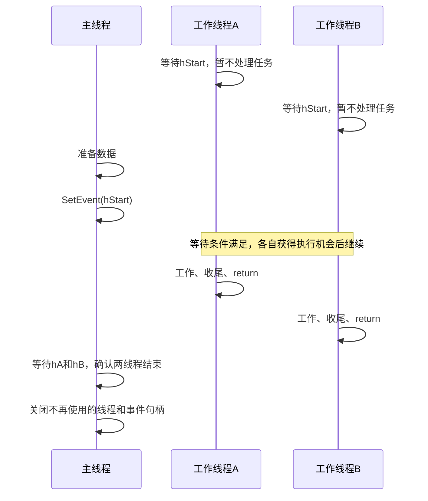

# 任务11：事件对象——让工作线程等待“允许开始”

日期：2026-11-04。本批顺序：任务10 → 任务11。先保存任务10的答案，再阅读本份；两份可以完成后一起提交，无须等我逐份生成或评阅。若任务10某处完全没懂，标记位置后在本份找对应解释，不把猜测写成确定结论。

建议20～25分钟，继续静态学习，不要求运行。对应本书1.4事件对象的第一部分。本课讲手动重置、通知与等待、何时清理；自动重置的完整比较及消息队列示例后续展开。

## 一、完整场景：两个线程等同一份“允许开始”通知

主线程创建工作线程A和B，但希望等准备工作完成后才允许它们开始处理任务。主线程不强行SuspendThread它们，而让每个工作线程主动执行等待。

为此创建一个事件对象hStart：

- 无信号：程序约定“还不允许开始”。
- 有信号：程序约定“允许开始”。

Windows负责维护这两种状态，并让等待事件的线程在条件满足时有机会继续；“允许开始”的业务含义由本程序约定。事件对象本身不保存一份文件、不执行任务，也不携带任务进度数字。

## 二、先对照原书

来源：王端明《深入浅出Windows API程序设计：核心编程篇》1.4，EPUB/xhtml/Chapter01_0005.xhtml，CreateEvent参数解释处。第一段为原文节选，保留措辞，止于手动重置说明，后续自动重置说明本次略去；第二段为完整原文。

> ● 可以把事件对象看作一个由Windows管理的标志，事件对象有两种状态：有信号和无信号状态，也称为触发和未触发状态。bManualReset参数指定创建的事件对象是手动重置还是自动重置类型，这里的重置可以理解为使之恢复为无信号（未触发）状态。如果设置为TRUE，则表示创建手动重置事件对象，可以调用SetEvent函数将事件对象状态设置为有信号，或调用ResetEvent函数将事件对象状态设置为无信号。如果事件对象为有信号状态，会一直保持到调用ResetEvent函数以后才转变为无信号状态。

> ● bInitialState参数指定事件对象创建时的初始状态。TRUE表示初始状态是有信号状态，FALSE表示初始状态是无信号状态。

原书还用ManualAuto示例演示手动重置事件放行多个工作线程。图1.3原图如下，来自EPUB/images/image_004.jpg；它是原书界面截图，不是本次用户运行记录：


图中先创建三个线程，随后用SetEvent发出通知。下面把同一机制缩成两个线程来讲清状态；完整原书工程代码在对应示例选读时再展开。

## 三、四个参数分别控制什么？

助手示例：

```cpp
HANDLE hStart = CreateEvent(NULL, TRUE, FALSE, NULL);
if (hStart == NULL)
{
    DWORD error = GetLastError();
    // 创建失败，保存/报告错误，不能继续拿hStart等待
}
```

| 位置 | 本例值 | 本例含义 |
|---|---|---|
| 第1个参数 | NULL | 默认安全属性，句柄不由子进程继承；本课不用跨进程 |
| 第2个参数bManualReset | TRUE | 手动重置：有信号后保持，直到显式ResetEvent |
| 第3个参数bInitialState | FALSE | 刚创建时无信号，工作线程需要等待 |
| 第4个参数lpName | NULL | 匿名事件；同一进程的线程共享传给它们的有效句柄即可 |

CreateEvent成功返回事件句柄，失败返回NULL。下面所有流程都假设创建、线程创建和通知/等待调用成功，句柄始终有效，没有其他代码提前关闭或复位事件；这是教学流程，不是含完整失败清理的可运行工程。

## 四、谁通知、谁等待、谁确认结束？

```text
主线程：创建hStart（手动重置，初始无信号）
主线程：创建工作线程A、B，把hStart交给它们
A、B：各自调用WaitForSingleObject(hStart, INFINITE)
       事件无信号时，调用线程在这里等待，暂时不执行后续任务
主线程：准备工作完成，成功调用SetEvent(hStart)
       hStart转为有信号并保持，A、B的等待可以得到满足
A、B：各自检查等待结果为WAIT_OBJECT_0后，执行自己的任务
       不保证两个线程同时执行，也不保证谁先执行
A、B：各自完成任务并return
主线程：分别等待hA、hB，确认两个工作线程都结束
主线程：不再使用时关闭hA、hB，最后关闭hStart
```

hStart是事件句柄；hA、hB是线程句柄，三个句柄对应不同对象。主线程SetEvent返回，只能说明这次设置状态的API调用成功，不能证明A/B已经开始、完成或者结束。

主线程不必等A/B已进入等待再SetEvent：只要这个手动重置事件保持有信号，稍后才开始等它的线程也能通过。本例的数据只在开始前准备，此后不改动；持续共享数据的并发访问另学同步机制，不能把事件当成自动保护所有数据的锁。

助手绘制的时间线（省略线程创建）：



图中先等再设置只是一个可能顺序，不是必须照这个先后发生；A/B结束先后也不作保证。

## 五、“手动重置”到底重置什么？

```cpp
BOOL ok = SetEvent(hStart);     // 无信号 -> 有信号
BOOL resetOk = ResetEvent(hStart); // 有信号 -> 无信号
```

这两行仅分别展示接口，不是让你发出通知后马上复位。两者成功返回非0，失败返回0并应立即保存GetLastError。

| 操作 | 改变事件的什么状态 | 已经通过等待的线程会怎样 |
|---|---|---|
| SetEvent成功 | 设为有信号；本来有信号则保持 | 允许相应等待得到满足，但不承诺任务完成 |
| ResetEvent成功 | 设为无信号 | 不把已通过等待的线程拉回去；之后再次等它才会受新状态影响 |

手动重置事件不会因为一个等待者通过就自动变成无信号。若A/B都在等待，保持有信号可使它们都通过；不是每次SetEvent只放行一个。多次SetEvent也不会累积成“通知次数”。

不要用“SetEvent后马上ResetEvent”来保证每个线程都收到一次通知：未及时通过等待的线程可能错过这段有信号状态。本例是一批工作只开始一次，所以保持有信号直到A/B都结束即可，不需要ResetEvent；有重复批次时，还要设计本批完成与下一批开始的完整协议。

## 六、资源清理为什么放在最后？

等待事件时还需要有效事件句柄。不能在A/B仍可能等待或使用hStart时，主线程就CloseHandle(hStart)。

本例先通知开始，再确认A/B各自结束，然后再关闭句柄。这里主线程按控制台情境安排等待；窗口主线程的消息响应安排在窗口示例里单独处理，不把无限等待直接塞进按钮处理函数。

## 七、两道短题：先遮住正文再作答

以下假设所有API调用成功，句柄有效，没有其他代码改变事件状态。

1. hStart是手动重置事件，初始无信号。A已在等它；主线程SetEvent后一直不ResetEvent，稍后B才开始等同一事件。A和B能否都通过等待？此时能否仅凭SetEvent成功就宣布它们的任务做完？说明理由。

我的回答与理由：

信心（高/中/低）：

2. A已经成功等到hStart并开始处理任务。主线程随后ResetEvent。A会自动退回等待点、暂停正在做的任务吗？若A做完一轮后再次等待hStart，且无人再SetEvent，它又会怎样？

我的回答与理由：

信心（高/中/低）：

实际用时（阅读/答题，未计时写未记录）：

是否回看材料/用了什么提示（包括是否先保存任务10答案再读本份）：

你可以将任务10/11一起完成，告诉我“两份完成”，或在聊天按“任务10第1题……、任务11第1题……”提交。当前答题顺序、提示和实耗如实记录，不要求每份都等我评阅才继续。

## 官方核对

2026-11-04核对：[CreateEvent参数与手动重置事件](https://learn.microsoft.com/en-us/windows/win32/api/synchapi/nf-synchapi-createeventw)、[SetEvent状态及返回值](https://learn.microsoft.com/en-us/windows/win32/api/synchapi/nf-synchapi-setevent)、[ResetEvent状态及返回值](https://learn.microsoft.com/en-us/windows/win32/api/synchapi/nf-synchapi-resetevent)。原书引用、原书截图与助手讲解已分别标注；不以助手材料作为用户运行证据。
