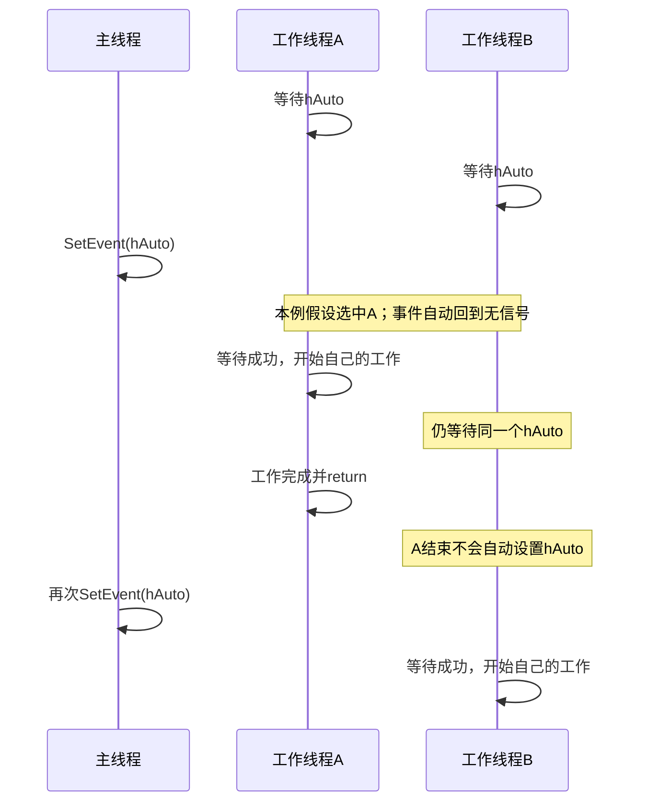

# 任务12：自动重置事件——一次通知怎样放行线程？

日期：2026-11-04。接任务11，建议阅读15分钟、两问5分钟；不要求运行。先保存任务11答案，再读本份，可将两份一起提交；如果已提前看过，请在提示栏如实记录。

目标：分清手动/自动重置，知道自动重置事件只放行一个等待者，以及多次SetEvent为什么不等于保存多次任务。

## 一、先看原书的三个线程示例

来源：王端明《深入浅出Windows API程序设计：核心编程篇》1.4，EPUB/xhtml/Chapter01_0005.xhtml，ManualAuto示例前后。以下两段为原文，保留措辞：

> 当线程成功等待到自动重置事件对象有信号时，事件对象会自动重置为无信号状态，因此自动重置事件对象通常不需要调用ResetEvent函数。手动和自动重置事件对象有一个很重要的区别：当一个手动重置事件对象转变为有信号状态时，正在等待该事件对象的所有线程都将变成可调度状态；而当一个自动重置事件对象转变为有信号状态时，只有一个正在等待该事件对象的线程可以变成可调度状态。

原书图1.3，来源EPUB/images/image_004.jpg，展示“创建三个线程”和“SetEvent”两个按钮；是原书截图，不是本次运行：


> 但是，如果把创建事件对象的代码改为g_hEvent = CreateEvent(NULL, FALSE, FALSE, NULL);来创建一个自动重置匿名事件对象，重新编译运行程序，先单击“创建三个线程”按钮，再单击“SetEvent”按钮，可以发现只有一个消息框弹出，这是因为在调用SetEvent函数后，系统只允许3个线程中的一个变成可调度状态，但是不确定会调度其中的哪个线程，剩下的2个线程则一直等待。

以下均为助手讲解。原书说一个线程“变成可调度状态”，表示可以获得执行机会；不是SetEvent替它执行工作，也不是承诺哪个线程先跑。

## 二、从一行代码看出区别

```cpp
// 手动重置，初始无信号，匿名
HANDLE hManual = CreateEvent(NULL, TRUE, FALSE, NULL);

// 自动重置，初始无信号，匿名
HANDLE hAuto = CreateEvent(NULL, FALSE, FALSE, NULL);
```

第二个参数控制手动/自动重置；第三个参数控制初始是否有信号，两个FALSE不要混在一起。CreateEvent成功返回句柄，失败返回NULL并先保存错误信息。

“自动重置”指系统在事件成功放行一个等待者时，将事件恢复成无信号。它不是创建后自动反复发通知，不是等工作线程完成任务才复位，也不是后台定时器。

下面假设各API调用成功、句柄有效，A/B各只等待本事件一次，没有别的代码设置、复位或关闭事件。

## 三、完整场景：A、B都等着，主线程通知一次

```text
主线程：创建hAuto，初始无信号
A：等待hAuto，暂不能越过等待点
B：等待hAuto，暂不能越过等待点
主线程：成功SetEvent(hAuto)
系统：让其中一个等待得到满足，同时将事件自动恢复为无信号
被选中的线程：等待返回WAIT_OBJECT_0，随后执行自己的工作
另一个线程：仍在等待，除非后续再有通知或其他结束等待的条件
```

不能凭创建先后或先调用等待，就认定一定先放行A。假设本次恰好放行A，只是为了讲后续过程：



这张图由助手绘制。第一次放行A并不意味着它必须先结束，主线程才可以再次通知；图只展示一种可能顺序。

A通过等待时就消耗了这次事件信号，事件复位不等A做完。A的线程对象有信号，表示A结束；hAuto是另一个对象，它不会因此自动变为有信号。

## 四、没有线程在等时，通知会怎样？

自动重置事件在无人等待时收到SetEvent，会保持有信号，直到一个等待者成功通过。稍后才来等的线程也可以通过，不需要通知和等待在同一时刻发生。

关键边界：**事件只有“有信号/无信号”两种状态，不会累加通知次数。**

例子：暂时没有任何线程等待，主线程连续成功调用三次SetEvent：

| 操作 | 原状态 | 操作后状态 | 保存了几份独立通知？ |
|---|---|---|---|
| 第一次SetEvent | 无信号 | 有信号 | 只保存一个有信号状态 |
| 第二次SetEvent | 有信号 | 仍有信号 | 不增加 |
| 第三次SetEvent | 有信号 | 仍有信号 | 不增加 |
| 随后一个线程成功等待 | 有信号 | 自动变无信号 | 本次信号被消耗 |

因此，不能把“我已经调用三次SetEvent”解释为“以后必定有三个线程各通过一次”。如果两次设置之间已经有线程消耗前一次信号，后一次才可以再提供一次放行机会；实际能放行几次取决于这个交错过程。

需要保存每一份任务时，要另有任务数据及相应的同步设计；后面会学能计数的信号量等工具。事件本身不替你排队保存任务，也不自动保护对共享任务数据的访问。

## 五、手动与自动重置，放在同一张表里

| 问题 | 手动重置事件 | 自动重置事件 |
|---|---|---|
| 第2个创建参数 | TRUE | FALSE |
| 一次有信号时，已有多个线程等它 | 保持有信号时，可让多个等待通过 | 放行其中一个等待者，然后自动无信号 |
| 无人等待时SetEvent | 保持有信号 | 也保持有信号，直到一个等待者通过 |
| 什么时候复位 | 程序显式ResetEvent | 成功放行一个等待者时由系统复位 |
| 对已处于有信号状态再SetEvent | 不累加次数 | 同样不累加次数 |

上表描述同一事件上的等待，不表示各线程任务已经完成。自动重置通常不需要手动ResetEvent；若主动复位一个尚未被消耗的信号，会清除这次状态，不能将它当成“总是更安全”的固定步骤。

SetEvent的返回值仍是API调用是否成功：非0成功，0失败；与有几个线程已开始或已完成是不同问题。工作线程应检查等待结果后再继续任务；确认它们全结束，仍要等待各自线程对象，随后再关闭不再使用的线程及事件句柄。

## 六、两道短题（遮住正文后回答）

以下只讨论同一进程，各API成功，句柄一直有效，除了题目给出的操作没有其他通知、复位、超时或终止事件。

1. hAuto是初始无信号的自动重置事件。在没有线程等待时，主线程连续SetEvent两次。随后A/B/C各开始等待一次。最终有几个等待能通过？另外的线程怎样？是否必定按A、B、C的顺序？说明原因。

我的回答与理由：

信心（高/中/低）：

2. A/B都已经等待同一自动重置事件，主线程SetEvent一次后，A通过等待并开始工作。此时事件是否还要等A工作结束才自动复位？如果A完成后仅return、没有再SetEvent，B会不会因为A结束而自动通过等待？说明原因。

我的回答与理由：

信心（高/中/低）：

实际用时（阅读/答题，未计时写未记录）：

是否回看材料/用了什么提示（是否先保存任务11再读本份）：

桌面填写保存后告诉我“任务12完成”，手机可按题号在聊天作答；任务11/12也可一起提交。理解、延迟保持和独立运行分别记录。

## 官方核对

2026-11-04核对：[Event Objects的自动重置、无人等待时的状态及非FIFO顺序](https://learn.microsoft.com/en-us/windows/win32/sync/event-objects)、[SetEvent对已设置事件的行为与返回值](https://learn.microsoft.com/en-us/windows/win32/api/synchapi/nf-synchapi-setevent)。原文与原图来自用户提供的EPUB，时间线和例子为助手补充。
