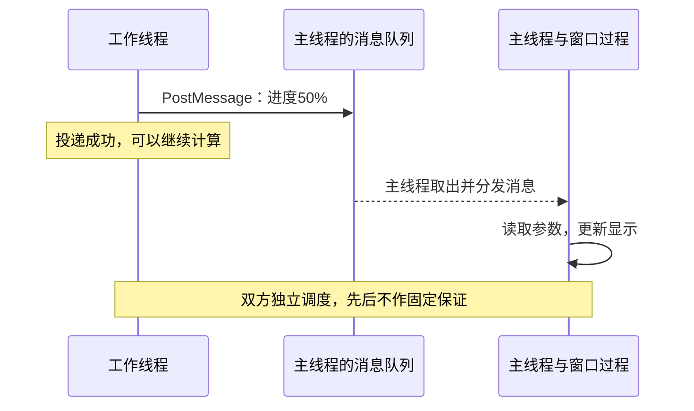

# 任务13：工作线程怎样把进度告诉窗口？

日期：2026-11-04。接任务12，建议阅读15～20分钟、两问5分钟；继续静态学习，不要求运行。先保存任务12答案再读本份；可连续完成12/13后一起提交。

对应本书1.4自定义消息部分，选读顺序为先事件、后窗口消息。本课目标：分清消息投递、窗口处理、线程结束，并理解PostMessage与跨线程SendMessage的等待关系。

## 一、从具体场景开始

主线程创建一个带进度显示的窗口，也负责处理按钮、拖动等窗口消息；工作线程执行耗时计算，算到50%时想更新显示。

我们采用这样的分工：工作线程计算并投递“进度50%”消息；主线程处理这条消息时更新自己的窗口。主线程在按钮处理里启动工作后尽快返回，继续处理窗口消息。

不是窗口一接到进度就自动理解50%的意思，程序要约定消息编号、参数含义，并写接收处理代码。以下假设窗口在整个通信期间有效，主线程持续运行消息循环。

## 二、原书是怎样引入的？

来源：王端明《深入浅出Windows API程序设计：核心编程篇》1.4，EPUB/xhtml/Chapter01_0005.xhtml，CustomMSG示例前。以下为完整原文段落：

> 工作线程向主线程发送自定义消息比较简单，调用SendMessage/PostMessage函数即可。下面通过一个示例来创建两个工作线程。

原书CustomMSG代码中还用下面的宏和调用通知主窗口“计数工作已完成”。这里只摘出这两行，省略其他代码，不把它们当作一个完整程序；仅统一空白：

```cpp
#define WM_CALCOVER (WM_APP + 2)
PostMessage(g_hwndDlg, WM_CALCOVER, 0, 0);
```

原书完整示例还有显示线程、PostThreadMessage和全局停止标志。为了先讲清消息流，本课以下用一个工作线程向主窗口投递进度的助手示例；两者不要混成同一份源码。线程消息队列的创建条件、共享标志的同步问题在对应主题另讲。

## 三、先认识四个角色

| 名称 | 含义 | 在本例中属于谁 |
|---|---|---|
| HWND hwnd | 窗口句柄，标识目标窗口 | 主线程创建的窗口 |
| 消息编号 | 用来区分“进度”“按钮点击”等信息 | 由系统或程序约定 |
| 消息队列 | 暂存投递消息的地方 | 目标窗口所属线程 |
| 窗口过程 | 处理发给窗口的消息的函数 | 本例由主线程执行 |

HWND不是工作线程句柄；它告诉PostMessage要把消息交给哪个窗口。窗口的所属线程取出消息，分发到窗口过程，窗口过程再根据消息编号决定怎么处理。

把消息循环理解为“持续取消息并分发”，把窗口过程理解为“具体处理消息的函数”。本课先认识它们的职责，不要求马上独立写完整窗口注册与创建代码。

## 补充：窗口由另一个线程创建时，消息由谁处理？

前文把窗口放在主线程，是本例的角色安排。对于这里的PostMessage(hwnd, ...)，一般规则是：**消息投给目标窗口所属线程的队列，由该线程的消息循环取出并分发到窗口过程。窗口所属线程就是创建该窗口的线程，不必是主线程。**

例如主线程没有窗口，线程B创建窗口hwndB并持续运行消息循环，线程A负责计算：

```cpp
// 在线程A中，向线程B创建的窗口报告进度
PostMessage(hwndB, WM_PROGRESS, 50, 0);
```

助手绘制的对应路径：


这个路径不需要经过主线程，也不需要有一个主窗口充当中转站。线程B承担这个窗口的界面处理职责；线程被称为“工作线程”并不禁止它创建窗口或运行消息循环。

“分发”是消息循环将消息交给相应窗口过程处理，不是先经过一个主窗口再转发给其他窗口。同一线程创建多个窗口时，它们的投递消息由该线程的队列和消息循环处理，再依据目标窗口分别分发。

但要区分“B创建窗口”和“B只是保存/使用了窗口句柄”：如果窗口实际由主线程创建，B拿到它的HWND并不会改变窗口所属线程，投递消息仍由创建它的主线程处理。判断归属要看创建者，不能只看哪个线程持有句柄。

另一个接口PostThreadMessage按线程ID投递，不绑定具体窗口；接收线程要先具备消息队列并自己取出、处理线程消息。这种消息通常不能直接用DispatchMessage送到窗口过程。它与本段PostMessage(hwndB, ...)的窗口消息路径分开理解，后面讲原书显示线程时再展开。

依据：[PostMessage的目标线程队列](https://learn.microsoft.com/en-us/windows/win32/api/winuser/nf-winuser-postmessagew)、[DispatchMessage的窗口过程分发](https://learn.microsoft.com/en-us/windows/win32/api/winuser/nf-winuser-dispatchmessagew)、[PostThreadMessage与窗口无关的线程消息](https://learn.microsoft.com/en-us/windows/win32/api/winuser/nf-winuser-postthreadmessagew)，2026-11-04核对。本补充是助手解释，不改写原书引用；原题条件仍是主线程创建窗口。

## 四、完整消息流：谁做了哪一步？

助手定义一个应用内使用的消息编号：

```cpp
#define WM_PROGRESS (WM_APP + 1)
```

WM_APP是应用自定义消息范围的起点，本例加1得到约定的编号。名字WM_PROGRESS是本程序起的；Windows不会因为这个名字就自动画进度条。

工作线程中的发送片段：

```cpp
BOOL posted = PostMessage(hwnd, WM_PROGRESS, 50, 0);
if (posted == 0)
{
    DWORD error = GetLastError();
    // 保存或报告投递失败；不能认定主窗口已经收到/处理
}
```

四个实参分别是目标窗口、消息编号、wParam、lParam。本程序约定wParam为进度整数，lParam暂时不用、设为0。本次传的是数值50，不是50所在变量的地址。

窗口过程里的对应片段：

```cpp
case WM_PROGRESS:
{
    UINT percent = (UINT)wParam;
    // 由本例主线程执行：使用percent更新进度显示
    // 本课略去具体控件绘制代码
    return 0;
}
```

以上是助手的接口/处理片段，窗口创建、完整消息循环及其他消息分支未列出，不能把它当完整可编译工程。把三步连起来才是本课要掌握的行为：

```text
工作线程：计算到50%，PostMessage投递消息
Windows：将消息放进目标窗口所属线程的消息队列
工作线程：这次调用不要求等待主线程处理，可以继续工作
主线程：有机会取到并分发这条消息
主线程：窗口过程匹配WM_PROGRESS，读取wParam里的50，更新显示
```

助手绘制的一种可能先后：



PostMessage返回非0，说明本次投递成功，不能据此确认界面已经更新。主线程可能处理得很快，也可能尚未处理；工作线程不等它处理完。

若以后要传结构体或字符串地址，PostMessage不会自动复制地址所指向的整份数据，需要另外安排数据寿命与所有权。先把本例的整数消息流掌握即可。

## 五、SendMessage为什么要单独区分？

以下比较同一进程的工作线程向主线程窗口发消息，且接收方正常处理、不采用提前答复等特殊机制：

| 接口 | 发送方是否等待窗口处理 | 返回值代表什么 |
|---|---|---|
| PostMessage | 不等待处理完成 | BOOL，非0投递成功，0失败 |
| SendMessage | 通常等目标窗口过程处理并返回 | LRESULT，含义取决于具体消息，不统一按0/非0判断成败 |

SendMessage是同步调用；发送方接下来能否继续，依赖接收方处理。不要把它和PostMessage只当成两个拼写不同的发送函数。

具体死锁场景：主线程在按钮处理函数里无限等待工作线程结束，不处理窗口消息；工作线程又SendMessage给主线程的窗口，等待主线程处理后自己才能继续并return。


谁也无法走到对方需要的下一步。避免这种设计：按钮处理启动工作后尽快返回，主线程继续处理消息；工作线程用PostMessage报告进度。这里只把SendMessage改成PostMessage，可以去掉发送方的这项等待，但主线程若仍在长时间等待，窗口依然不能及时处理后续消息。

## 六、三种“成功”各说明什么？

1. 消息投递成功：投进了队列，不证明处理完成。
2. 窗口处理了“进度50%”：处理了本条进度信息，不证明工作线程结束。
3. 等待线程对象得到WAIT_OBJECT_0：确认线程结束。

即使消息名字叫“工作完成”，也要看程序在哪一步发出它：如果工作线程先PostMessage再return，主线程可能在线程return前就处理到消息。消息能表示程序约定的计算已完成，不能自动替代对线程终止的确认。

## 七、两问（遮住讲解后作答）

1. 工作线程向主线程创建的窗口PostMessage，参数表示进度75%，调用返回非0。主线程的窗口过程由哪个线程执行？此时能否确认界面已经显示75%？为什么？

我的回答与理由：

信心（高/中/低）：

2. 主线程的按钮处理函数无限等待工作线程结束，工作线程又用SendMessage通知这个主窗口、等处理返回后才准备return。指出双方各在等谁。只把SendMessage改成PostMessage，能否保证主窗口一直响应？你会怎样调整主线程的安排？

我的回答与理由：

信心（高/中/低）：

实际用时（阅读/答题，未计时写未记录）：

是否回看材料/用了什么提示（是否先保存任务12答案再读本份）：

桌面保存后告诉我“任务13完成”，或在手机聊天分题号回答；任务12/13可连续学习后一起提交。元数据如实记录，文字答题不替代独立运行。

## 官方核对

2026-11-04核对：[PostMessage的投递、参数与BOOL返回值](https://learn.microsoft.com/en-us/windows/win32/api/winuser/nf-winuser-postmessagew)、[SendMessage的跨线程等待及返回值](https://learn.microsoft.com/en-us/windows/win32/api/winuser/nf-winuser-sendmessagew)、[消息队列与窗口过程的分发关系](https://learn.microsoft.com/en-us/windows/win32/winmsg/about-messages-and-message-queues)。本次选段没有原书配图，图由助手绘制。后续进入1.5同步时，会针对初测中“少次操作不会覆盖”的缺口补具体交错与验收。
