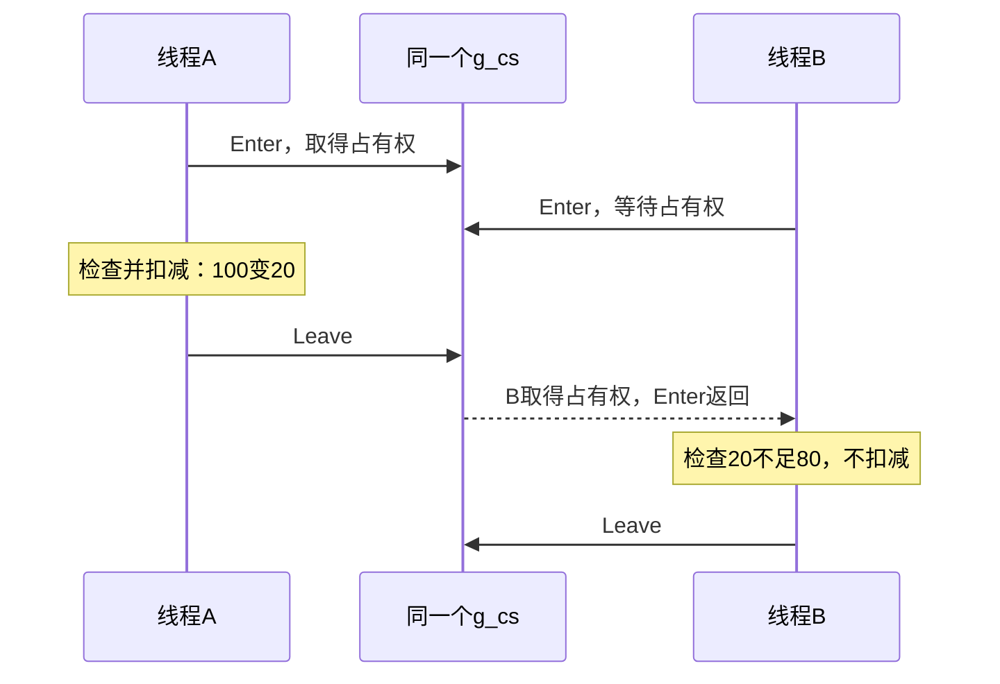

# 任务15：关键段——保护一整段共享操作

日期：2026-11-04。接任务14，建议阅读20分钟、两问5分钟；本课采用阅读与推演。先保存任务14答案，再读本份；14/15可连续完成后一起提交。

对应本书1.5“2．关键段”。目标：理解所有参与线程进入同一个关键段，为什么能保护“检查条件并更新数据”这一整段；分清初始化、进入、离开和最终销毁。

**本课前提：** 正确范例中，A/B处于同一进程，共用已初始化的g_cs；余额的所有并发访问都用它保护，扣减金额为正。代码按正常调用路径执行，练习中的变化以各题条件为准。

## 一、先看完整问题：检查后扣减余额

共享余额为100，A/B都想扣80，程序规则是“余额足够才扣减”。把检查放在锁外，就允许这样的交错：A读到100，判断够用；B也读到100，判断够用。双方都根据同一个旧余额作出了扣款决定。

要保护的是“检查余额 → 确认够用 → 扣减”这一整段。只把最后的扣减改成原子操作，前面的条件检查仍然留在保护范围之外。

下面把检查和扣减一并放进同一个关键段，直接推演同步后的结果。

## 二、对照原书，先厘清保护对象

来源：王端明《深入浅出Windows API程序设计：核心编程篇》1.5，EPUB/xhtml/Chapter01_0006.xhtml，“2．关键段”首段。以下是完整原文，保留措辞：

> 关键段（Critical Section）对象也称为临界区对象，即把操作共享资源的一段代码保护起来，当一个线程正在执行操作共享资源的这段代码时，其他试图访问共享资源的线程都将被挂起，一直等待到前一个线程执行完，其他线程才可以执行操作共享资源的代码。当然，系统也可以暂停当前线程去调度其他线程，但是在当前线程离开关键段前，系统是不会去调度任何想要访问同一资源的其他线程的。

按当前官方接口，准确规则是：**同一时刻只有一个线程占有这份关键段。其他线程可以执行无关代码；要进入这份已被占用的关键段，就在Enter处等待。** 持锁线程仍受系统调度，锁保护的是共同约定的访问区间。

系统不会自动识别“这个变量已经有人保护”，也不会拦住绕过关键段的普通读写。关键段的作用依赖所有相关参与者使用同一份保护规则。

本节没有单独的新原书配图，下方时间线由助手绘制。

## 三、先认清四个动作

原书列出的四个接口，以下省略SAL注解并统一空白，保留函数名与参数类型：

```cpp
VOID WINAPI InitializeCriticalSection(LPCRITICAL_SECTION lpCriticalSection);
VOID WINAPI EnterCriticalSection(LPCRITICAL_SECTION lpCriticalSection);
VOID WINAPI LeaveCriticalSection(LPCRITICAL_SECTION lpCriticalSection);
VOID WINAPI DeleteCriticalSection(LPCRITICAL_SECTION lpCriticalSection);
```

LPCRITICAL_SECTION是指向CRITICAL_SECTION结构的指针，&g_cs就是这份对象的地址。上面省略了参数检查用的SAL注解。

| 动作 | 谁在何时做 | 具体作用 |
|---|---|---|
| Initialize | 主线程，在任何使用者开始前做一次 | 初始化这份关键段对象 |
| Enter | 每个要访问受保护数据的线程 | 请求占有同一个关键段；若其他线程占有，就等待 |
| Leave | 成功进入的持有线程，在本段操作结束时做 | 交还占有权，允许其他参与者进入 |
| Delete | 确认所有使用者不再使用后做一次 | 最终释放关键段相关资源 |

这四个接口返回void。Enter正常返回，就表示调用线程已取得占有权。关键段用于同一进程内的线程。

## 四、把检查和扣减放在同一个区间

核心函数如下。初始化与最终清理见第六节：

```cpp
CRITICAL_SECTION g_cs;
int g_balance = 100;

bool TryWithdraw(int amount)
{
    bool success = false;

    EnterCriticalSection(&g_cs);

    if (g_balance >= amount)   // 检查也必须在保护区间内
    {
        g_balance -= amount;
        success = true;
    }

    LeaveCriticalSection(&g_cs);
    return success;
}
```

A/B都调用同一个函数、传入80。假定这次A先进入：

```text
A：Enter返回，已经占有g_cs
A：检查100足够，扣80，余额变20
B：尝试Enter同一个g_cs；若A还没Leave，B在这里等待
A：Leave，交还占有权
B：Enter返回，此时才检查余额，看到20不足80，不扣减
B：Leave
```

A、B都允许先进入。无论谁先，结果都是一人成功、余额20；接口不规定谁先取得锁。

助手绘制的一种可能顺序：



两条线程必须传入同一个&g_cs。A用csA、B用csB，就是两把独立的锁，双方可以各自取得自己的锁；这样没有建立两条线程之间的互斥。

## 五、为什么不能先检查，再进入？

```text
错误范围：先检查余额足够 → Enter → 扣减 → Leave
正确范围：Enter → 检查余额是否足够 → 决定是否扣减 → Leave
```

前一种安排中，两个线程仍可能在占有关键段之前都通过检查；只保护扣减不保护决策，无法保证“余额足够才扣”。正确范围要覆盖这条规则所依赖的整个读、判断、更新过程。

任何需要与更新一致的并发读取，也应遵循对应的保护方案。只让写线程进入、读线程直接读，不会自动获得同样保证。

## 六、谁初始化，谁最后销毁？

控制台程序按下面顺序管理这份关键段：

```text
主线程：InitializeCriticalSection(&g_cs)
主线程：创建A/B，让它们分别调用TryWithdraw
A/B：各次成功Enter后，在操作结束时对应Leave
主线程：分别等待A/B，检查结果，确认它们已经结束
主线程：关闭不再使用的线程句柄
主线程：确认不再有线程使用、等待或占有g_cs
主线程：DeleteCriticalSection(&g_cs)
```

原书说明离开与销毁时的两段原文：

> 执行完操作共享资源的代码后，需要调用LeaveCriticalSection函数释放对关键段对象的所有权，以便其他正在等待的线程获得关键段对象的所有权并执行操作共享资源的代码。

> 不再需要关键段对象时需要调用DeleteCriticalSection函数释放关键段对象，该函数会释放关键段对象使用的所有系统资源。

Leave交还本次占有权；Delete清理整份关键段。清理时机是：所有使用者都已结束，不再有线程占有、等待或再次使用它。

关键段g_cs用DeleteCriticalSection清理；线程和事件的句柄用CloseHandle关闭。初始化后的g_cs保持原位，使用这同一份对象。

本例所有分支都先Leave，再return。把关键段内的操作保持短小；窗口通知等操作放到锁外，具体方法接着在任务16里讲。

本课先记住：每次Enter对应一次Leave。线程获得关键段的先后顺序由系统调度，接口不规定先来先到。

## 七、两道短题（遮住正文后回答）

1. 余额初始100。A想扣70，B想扣60；它们都通过同一份已初始化的g_cs，把“检查够不够及扣减”全部放在Enter/Leave之间。没有其他访问，主线程最后成功等两者结束。能否两人都扣成功？最终余额可能是多少？是否保证A先成功？说明理由。

我的回答与理由：

信心（高/中/低）：

2. A用csA、B用csB保护同一个余额，各自初始化并进入自己的关键段，这能保证双方互斥吗？应该怎样改？另外，主线程仅知道自己已经Leave，就立刻Delete那份仍会被工作线程使用的关键段，是否可行？给出正确清理时机。

我的回答与理由：

信心（高/中/低）：

实际用时（阅读/答题，未计时写未记录）：

是否回看材料/用了什么提示（是否先保存任务14答案再读本份）：

桌面保存后告诉我“任务15完成”，或在手机聊天按题号作答；14/15可以一起交。原子递增、关键段区间、延迟保持和独立运行分开记录，预先拿到材料不表示已通过。

## 官方核对

2026-11-04核对：[Critical Section Objects的单进程范围、互斥及线程仍可运行](https://learn.microsoft.com/en-us/windows/win32/sync/critical-section-objects)、[EnterCriticalSection占有权与正常返回](https://learn.microsoft.com/en-us/windows/win32/api/synchapi/nf-synchapi-entercriticalsection)、[InitializeCriticalSection初始化与对象管理](https://learn.microsoft.com/en-us/windows/win32/api/synchapi/nf-synchapi-initializecriticalsection)、[DeleteCriticalSection清理前提](https://learn.microsoft.com/en-us/windows/win32/api/synchapi/nf-synchapi-deletecriticalsection)。原书文字与助手示例/图/官方纠正分别标注，不把未运行片段当作用户实践。
